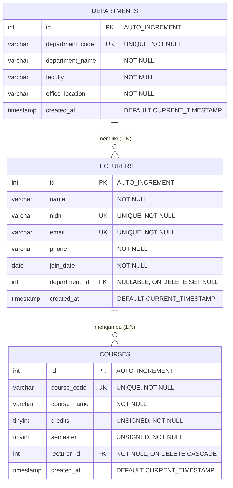
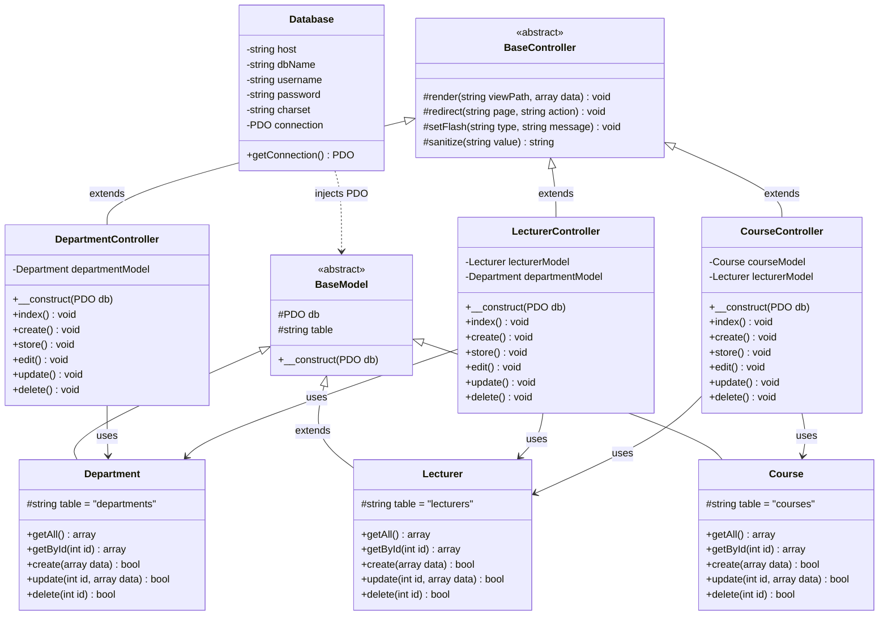
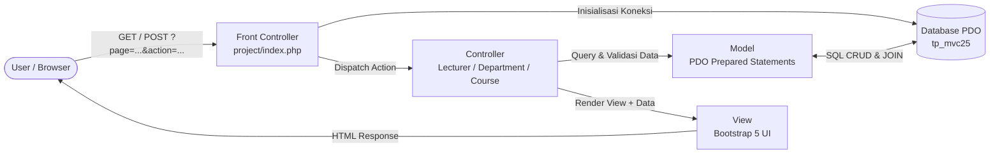

# Janji
Saya Muhammad Dzaka Indrianto dengan NIM 2508755 mengerjakan Tugas Praktikum 8 pada Mata Kuliah Desain dan Pemrograman Berorientasi Objek (DPBO) untuk keberkahan-Nya maka saya tidak melakukan kecurangan seperti yang telah dispesifikasikan. Aamiin

# Fitur Utama

Aplikasi ini mendukung fungsionalitas CRUD (Create, Read, Update, Delete) penuh untuk tiga entitas utama:

- **CRUD Lecturers:** Menambah, melihat, mengubah, dan menghapus data dosen.
- **CRUD Departments:** Menambah, melihat, mengubah, dan menghapus data departemen.
- **CRUD Courses:** Menambah, melihat, mengubah, dan menghapus data mata kuliah.

## Relasi Database
- **Departments ke Lecturers (1-N):** Satu departemen dapat memiliki banyak dosen (`lecturers.department_id` berelasi ke `departments.id` dengan `ON UPDATE CASCADE ON DELETE SET NULL`).
- **Lecturers ke Courses (1-N):** Satu dosen dapat mengampu banyak mata kuliah (`courses.lecturer_id` berelasi ke `lecturers.id` dengan `ON UPDATE CASCADE ON DELETE CASCADE`).

# Struktur Arsitektur MVC

Proyek ini dibangun menggunakan PHP Native (OOP & PDO) dan dibagi ke dalam lapisan konfigurasi, Model, View, Controller, serta satu Router utama.

- **`index.php` (Router Utama / Front Controller)**
  - File ini adalah satu-satunya gerbang masuk (*single entry point*) untuk semua permintaan.
  - Tugasnya membaca parameter `?page=` dan `?action=` dari URL (default: `page=lecturers&action=index`).
  - Berdasarkan URL, file ini akan memuat kelas Controller yang sesuai dan memanggil method (*action*) yang diminta (`index`, `create`, `store`, `edit`, `update`, atau `delete`).

- **`/config/` (Konfigurasi Database)**
  - `Database.php`: Mengelola koneksi ke server MySQL menggunakan **PDO (PHP Data Objects)** dengan mode *exception* dan menonaktifkan emulasi *prepared statement*.

- **`/models/` (Model)**
  - Bertanggung jawab untuk seluruh interaksi dengan database menggunakan *PDO Prepared Statements*.
  - `BaseModel.php`: Kelas abstrak dasar (induk) yang menyimpan instance koneksi database dan nama tabel.
  - `Department.php`: Berisi query SQL untuk CRUD tabel `departments` (termasuk `LEFT JOIN` dengan `lecturers` untuk menghitung jumlah dosen).
  - `Lecturer.php`: Berisi query SQL untuk CRUD tabel `lecturers` (termasuk `LEFT JOIN` ke `departments`).
  - `Course.php`: Berisi query SQL untuk CRUD tabel `courses` (termasuk `INNER JOIN` ke `lecturers` dan `LEFT JOIN` ke `departments`).

- **`/controllers/` (Controller)**
  - Bertindak sebagai "otak" aplikasi yang menghubungkan Model dan View, memvalidasi serta menyaring input, dan mengatur notifikasi *flash message* (`$_SESSION['flash']`).
  - `BaseController.php`: Kelas abstrak induk yang menyediakan method bantu `render()`, `redirect()`, `setFlash()`, dan `sanitize()`.
  - `LecturerController.php`: Mengatur logika CRUD dosen (juga memanggil model `Department` untuk data *dropdown*).
  - `DepartmentController.php`: Mengatur logika CRUD departemen.
  - `CourseController.php`: Mengatur logika CRUD mata kuliah (juga memanggil model `Lecturer` untuk data *dropdown* dosen pengampu).

- **`/views/` (View)**
  - Bertanggung jawab untuk antarmuka pengguna (UI) berbasis Bootstrap 5.
  - `/layouts/`: Berisi `header.php` (navbar & tampilan *flash alert*) dan `footer.php` (footer & pemanggilan script JS).
  - `/lecturers/`, `/departments/`, `/courses/`: Setiap folder entitas dipisah secara modular menjadi 3 file tampilan:
    1. `index.php` (Tabel daftar data)
    2. `create.php` (Form tambah data)
    3. `edit.php` (Form ubah data)

# Struktur Proyek

Proyek ini menggunakan arsitektur MVC (Model-View-Controller).

```text
tp_mvc25
├── project/
│   ├── assets/
│   │   ├── css/
│   │   │   └── bootstrap.min.css
│   │   └── js/
│   │       ├── bootstrap.bundle.min.js
│   │       ├── bootstrap.min.js
│   │       ├── jquery.min.js
│   │       └── popper.min.js
│   │
│   ├── config/
│   │   └── Database.php
│   │
│   ├── controllers/
│   │   ├── BaseController.php
│   │   ├── CourseController.php
│   │   ├── DepartmentController.php
│   │   └── LecturerController.php
│   │
│   ├── models/
│   │   ├── BaseModel.php
│   │   ├── Course.php
│   │   ├── Department.php
│   │   └── Lecturer.php
│   │
│   ├── views/
│   │   ├── courses/
│   │   │   ├── create.php
│   │   │   ├── edit.php
│   │   │   └── index.php
│   │   ├── departments/
│   │   │   ├── create.php
│   │   │   ├── edit.php
│   │   │   └── index.php
│   │   ├── layouts/
│   │   │   ├── footer.php
│   │   │   └── header.php
│   │   └── lecturers/
│   │       ├── create.php
│   │       ├── edit.php
│   │       └── index.php
│   │
│   └── index.php
│
├── dokumentasi/
│   └── Record.mp4
│
├── tp_mvc25.sql
└── README.md
```

# Diagram

## 1. Entity Relationship Diagram (ERD)



## 2. Class Diagram (Arsitektur OOP & MVC)



## 3. Alur Request-Response MVC



# Database

```sql
CREATE DATABASE IF NOT EXISTS `tp_mvc25`
  DEFAULT CHARACTER SET utf8mb4
  COLLATE utf8mb4_unicode_ci;

USE `tp_mvc25`;

CREATE TABLE `departments` (
  `id` INT NOT NULL AUTO_INCREMENT,
  `department_code` VARCHAR(15) NOT NULL,
  `department_name` VARCHAR(100) NOT NULL,
  `faculty` VARCHAR(100) NOT NULL,
  `office_location` VARCHAR(100) NOT NULL,
  `created_at` TIMESTAMP NOT NULL DEFAULT CURRENT_TIMESTAMP,
  PRIMARY KEY (`id`),
  UNIQUE KEY `uq_department_code` (`department_code`)
) ENGINE=InnoDB DEFAULT CHARSET=utf8mb4 COLLATE=utf8mb4_unicode_ci;

INSERT INTO `departments` (`id`, `department_code`, `department_name`, `faculty`, `office_location`) VALUES
(1, 'ILKOM', 'Ilmu Komputer', 'FPMIPA', 'Gedung FPMIPA C Lt. 2'),
(2, 'PEND-IK', 'Pendidikan Ilmu Komputer', 'FPMIPA', 'Gedung FPMIPA C Lt. 3'),
(3, 'RPL', 'Rekayasa Perangkat Lunak', 'FPMIPA', 'Gedung JICA Lt. 4');

CREATE TABLE `lecturers` (
  `id` INT NOT NULL AUTO_INCREMENT,
  `name` VARCHAR(100) NOT NULL,
  `nidn` VARCHAR(20) NOT NULL,
  `email` VARCHAR(100) NOT NULL,
  `phone` VARCHAR(20) NOT NULL,
  `join_date` DATE NOT NULL,
  `department_id` INT NULL,
  `created_at` TIMESTAMP NOT NULL DEFAULT CURRENT_TIMESTAMP,
  PRIMARY KEY (`id`),
  UNIQUE KEY `uq_lecturer_nidn` (`nidn`),
  UNIQUE KEY `uq_lecturer_email` (`email`),
  KEY `idx_lecturers_department_id` (`department_id`),
  CONSTRAINT `fk_lecturers_department`
    FOREIGN KEY (`department_id`)
    REFERENCES `departments` (`id`)
    ON UPDATE CASCADE
    ON DELETE SET NULL
) ENGINE=InnoDB DEFAULT CHARSET=utf8mb4 COLLATE=utf8mb4_unicode_ci;

INSERT INTO `lecturers` (`id`, `name`, `nidn`, `email`, `phone`, `join_date`, `department_id`) VALUES
(1, 'Dr. Budi Santoso, M.T.', '0012048501', 'budi.santoso@kampus.ac.id', '081234567801', '2018-09-01', 1),
(2, 'Rina Wulandari, S.Kom., M.Cs.', '0023089002', 'rina.wulandari@kampus.ac.id', '081234567802', '2020-02-15', 1),
(3, 'Ahmad Fauzi, M.Kom.', '0015068803', 'ahmad.fauzi@kampus.ac.id', '081234567803', '2019-08-10', 2),
(4, 'Siti Nurhaliza, Ph.D.', '0004118704', 'siti.nurhaliza@kampus.ac.id', '081234567804', '2017-01-20', 3);

CREATE TABLE `courses` (
  `id` INT NOT NULL AUTO_INCREMENT,
  `course_code` VARCHAR(15) NOT NULL,
  `course_name` VARCHAR(120) NOT NULL,
  `credits` TINYINT UNSIGNED NOT NULL,
  `semester` TINYINT UNSIGNED NOT NULL,
  `lecturer_id` INT NOT NULL,
  `created_at` TIMESTAMP NOT NULL DEFAULT CURRENT_TIMESTAMP,
  PRIMARY KEY (`id`),
  UNIQUE KEY `uq_course_code` (`course_code`),
  KEY `idx_courses_lecturer_id` (`lecturer_id`),
  CONSTRAINT `fk_courses_lecturer`
    FOREIGN KEY (`lecturer_id`)
    REFERENCES `lecturers` (`id`)
    ON UPDATE CASCADE
    ON DELETE CASCADE
) ENGINE=InnoDB DEFAULT CHARSET=utf8mb4 COLLATE=utf8mb4_unicode_ci;

INSERT INTO `courses` (`id`, `course_code`, `course_name`, `credits`, `semester`, `lecturer_id`) VALUES
(1, 'IK201', 'Desain dan Pemrograman Berorientasi Objek', 3, 3, 1),
(2, 'IK205', 'Struktur Data dan Algoritma', 4, 3, 2),
(3, 'IK302', 'Kecerdasan Buatan', 3, 5, 1),
(4, 'PI204', 'Basis Data Relasional', 3, 3, 3),
(5, 'RP301', 'Arsitektur Perangkat Lunak', 3, 5, 4);
```

# Dokumentasi

Rekaman demonstrasi aplikasi (*screen record*) yang menampilkan alur operasi **Create**, **Read**, **Update**, dan **Delete** pada seluruh tabel (**Lecturers**, **Departments**, dan **Courses**) tersimpan di [`dokumentasi/Record.mp4`](dokumentasi/Record.mp4).
